# Testes e evidências (US-07)

## Resultado real na org `minha_nova_org` (24/10/2026)

- Deploy: **85 componentes implantados**; a FlexiPage `Negociacao_Comercial_Record_Page` foi excluída porque a validação do Salesforce rejeitou seu XML Dynamic Forms. A página e seu action override precisam ser configurados no Lightning App Builder antes de definir a página padrão.
- Testes Apex (`RunLocalTests`): **40 executados, 40 aprovados, 0 falhas**. Cobertura global da org: **92%**.
- Os dois Flows foram confirmados como **Active**, versão 1: `Negociacao_Roteamento_Aprovacao` e `Negociacao_Decisao_Aprovacao`.
- Permission Sets `Training_Vendedor` e `Training_Aprovador_Diretor` atribuídos ao usuário autenticado.
- Standard Price Book ativado; seed criou 5 produtos/entradas ativas e a Opportunity `006ak00000fxAyHAAU`.

### Cobertura por classe de produção

| Classe | Cobertura |
|---|---:|
| `TrainingApprovalDecisionAction` | 100% |
| `TrainingApprovalMatrix` | 94,44% |
| `TrainingApprovalRoutingAction` | 100% |
| `TrainingApprovalService` | 94,25% |
| `TrainingApproverResolver` | 85,71% |
| `TrainingConstants` | 100% |
| `TrainingException` | 100% |
| `TrainingHistoryService` | 100% |
| `TrainingNegotiationContext` | 100% |
| `TrainingNegotiationController` | 100% |
| `TrainingNegotiationHandler` | 90,44% |
| `TrainingNegotiationItemHandler` | 97,30% |
| `TrainingNegotiationItemTrigger` | 100% |
| `TrainingNegotiationRecalcService` | 85,71% |
| `TrainingNegotiationRequest` | 100% (sem linhas executáveis) |
| `TrainingNegotiationService` | 91,11% |
| `TrainingNegotiationTrigger` | 100% |
| `TrainingOrderController` | 100% |
| `TrainingOrderService` | 89,77% |

### Verificação funcional executada

| Cenário | Resultado |
|---|---|
| 4% | **PASS** — Aprovada automaticamente, sem Task |
| 12% + justificativa | **PASS** — Pendente, nível Diretor; permaneceu exatamente 1 Task após salvar novamente |
| Decisão repetida | **PASS** — bloqueada com “Esta negociação já foi resolvida” |
| Alterar item de negociação aprovada via DML | **PASS** — bloqueado pela validação da Trigger |
| Gerar Order duas vezes | **PASS** — as duas chamadas retornaram o mesmo Order; 1 registro no total |

Os roteiros acima foram executados por Execute Anonymous e os resultados foram observados no log da org. A verificação visual da FlexiPage continua pendente no Lightning App Builder.

### Revalidação da integridade de preços (24/10/2026)

- O handler de itens agora exige uma entrada ativa do Pricebook da Opportunity e rejeita preço unitário divergente em DML direto.
- Validação Salesforce em modo `check-only`: **41 testes executados, 0 falhas** (`TrainingNegotiationTriggerTest`, `TrainingNegotiationServiceTest`, `TrainingApprovalServiceTest` e `TrainingOrderServiceTest`).
- Esta validação não implantou as alterações na org. A correção permanece local até um deploy posterior.

## Apex
```bash
sf apex run test --test-level RunLocalTests --code-coverage --result-format human --wait 30 --target-org minha_nova_org
```
Meta: ≥ 85% nas classes do desafio. Classes de teste: `TrainingNegotiationServiceTest`, `TrainingNegotiationTriggerTest`,
`TrainingApprovalServiceTest`, `TrainingOrderServiceTest` (+ `TrainingTestDataFactory`). Os testes criam seus próprios dados
(usuários, produtos, pricebook entries, oportunidades) e usam `System.runAs` com os Permission Sets reais.
Anexe aqui: print do resultado + cobertura por classe.

## Como cada Flow é validado

### Record-Triggered Flow `Negociacao_Roteamento_Aprovacao`
Como é validado: (a) **testes Apex** (`TrainingApprovalServiceTest`) executam o Flow de verdade ao fazer `update Status__c = 'Pendente'`;
(b) **Flow Debug** (Flow Builder → *Debug* → informar um registro em Rascunho com itens → *Run with rollback*), e
(c) roteiro manual abaixo.

| # | Dado | Ação | Resultado esperado | Evidência |
|---|---|---|---|---|
| 1 | 4% | Enviar | `Aprovada`, nível Automática, histórico "Aprovada automaticamente", **sem** Task | print do registro + Histórico |
| 2 | 12% + justificativa | Enviar | `Pendente`, nível Diretor, 1 Task para o aprovador, `Aprovador__c` preenchido | print Task |
| 3 | mesmo registro | salvar de novo (sem mudar Status) | nenhuma Task nova | contagem de Tasks = 1 |
| 4 | rejeitada → Rascunho → enviar | Enviar | ciclo 2, Task nova (chave `Id-2`) | 2 Tasks, histórico com 2 "Submetida" |
| 5 | 8% sem justificativa | Enviar | bloqueado pela Trigger (mensagem amigável) | print do erro |

### Screen Flow `Negociacao_Decisao_Aprovacao`
Validação: **Flow Debug** informando `recordId` de uma negociação Pendente + testes Apex da ação `TrainingApprovalDecisionAction`
(autorizado, não autorizado, motivo vazio, decisão repetida).

| # | Usuário | Ação | Resultado esperado |
|---|---|---|---|
| 1 | Diretor | Aprovar | `Aprovada`, decisor + data/hora, histórico, Task concluída |
| 2 | Diretor | Rejeitar sem motivo | tela não avança (campo obrigatório) e, via Apex, erro "Informe o motivo" |
| 3 | Diretor | Rejeitar com motivo | `Rejeitada`, motivo exibido na página |
| 4 | Vendedor / aprovador de outro nível | tentar decidir (Flow ou Apex) | falha "Você não tem permissão..." |
| 5 | Diretor | decidir de novo | "Esta negociação já foi resolvida" |

## Validação manual pela interface (24/10/2026)
| Cenário | Resultado observado |
|---|---|
| Simulador, 5% | NEG-0005 Aprovada, nível Automática (5% é o limite da faixa automática) |
| Simulador, 6% sem aprovador Gerente | Bloqueado: "Nenhum aprovador ativo foi encontrado para o nível Gerente" |
| Simulador, 6% após atribuir `Training_Aprovador_Gerente` | NEG-0008 Pendente, nível Gerente, valor final R$ 75.200,00 |
| Simulador, 12% | NEG-0007 Pendente, nível Diretor |
| Simulador, 20% | NEG-0010 Pendente, nível Diretor (a faixa do Diretor vai até 20%) |
| Simulador, 25% | NEG-0011 Pendente, nível Financeiro, valor final R$ 54.375,00 |
| Rascunho | NEG-0009 em Rascunho, botões Editar no simulador / Enviar / Cancelar; ao enviar com 4% foi Aprovada automaticamente |
| Rejeitar sem motivo (Screen Flow) | Bloqueado: campo obrigatório |
| Rejeitar com motivo | NEG-0007 rejeitada com sucesso |
| Reabrir, ciclo 2, aprovar | NEG-0007 Aprovada, ciclo 2 |
| Gerar pedido | Order 00000103 em Draft, R$ 44.000,00 (valor final da negociação) |
| Gerar pedido novamente | Botão vira "Abrir pedido gerado"; consulta mostra 1 Order por negociação |

Correção encontrada nesta validação: o LWC passa a enviar o pedido de salvamento como JSON
(`TrainingNegotiationController.saveNegotiation(String requestJson, Boolean submit)`), pois a lista de
itens chegava vazia ao Apex ("Adicione ao menos um produto à negociação."). Testes: 41/41.

## Evidências (prints em `docs/evidencias/`)
Testes Apex: 41/41 aprovados, cobertura da org 92% (RunLocalTests, 24/10/2026). Saída completa em
[`evidencias/testes-apex-cobertura.txt`](evidencias/testes-apex-cobertura.txt).
O teste `approverResolverRejectsUnknownAndUnassignedLevels` passou a aceitar tanto "sem aprovador" quanto
"com aprovador" para o nível Financeiro, pois o resultado depende dos Permission Sets atribuídos na org
(atribuí os de Gerente e Financeiro ao usuário de teste durante a validação manual).

| Estado / cenário | Print |
|---|---|
| Aprovada automática (5%) | 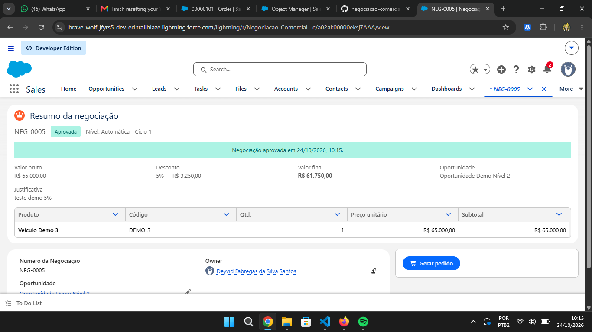 |
| Erro: sem aprovador Gerente (6%) | 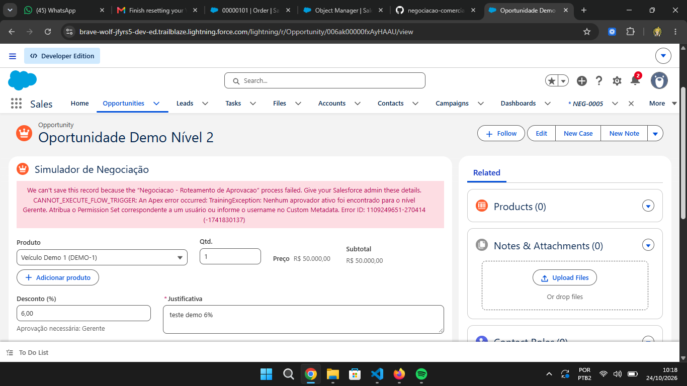 |
| Pendente, Diretor (12%) |  |
| Rejeitar sem motivo bloqueado | 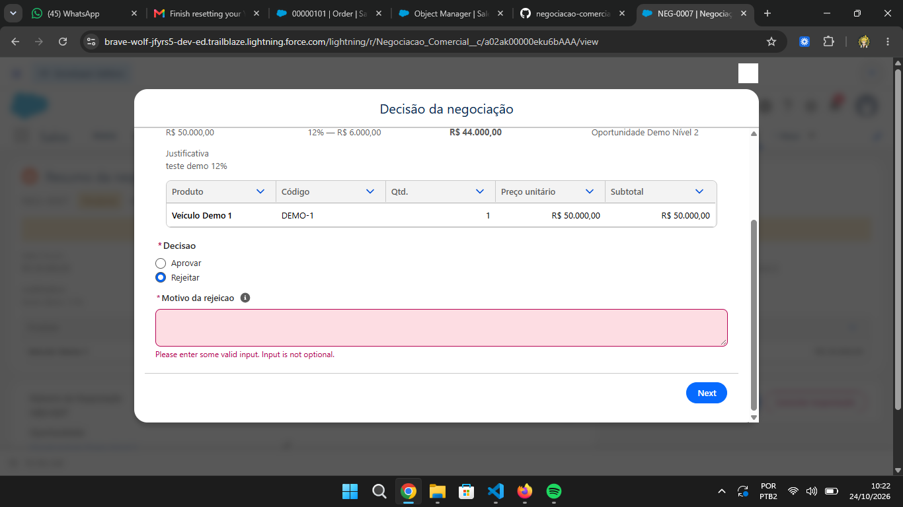 |
| Rejeitada com sucesso (Flow) | 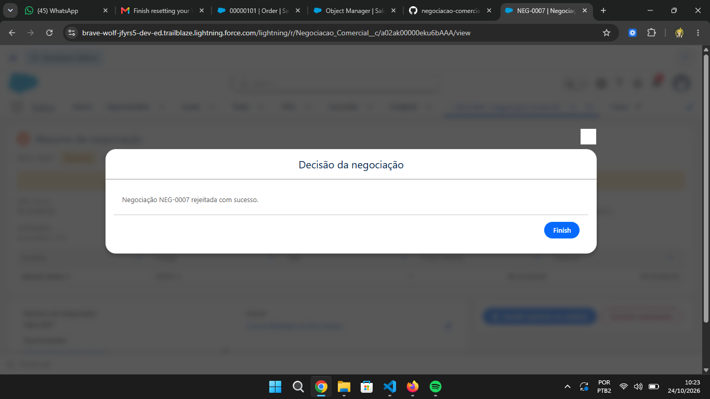 |
| Pedido gerado (Order 00000103) | 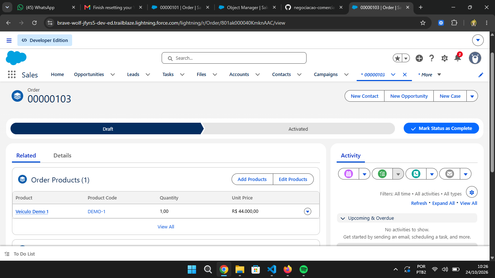 |
| Aprovada + "Abrir pedido gerado" | 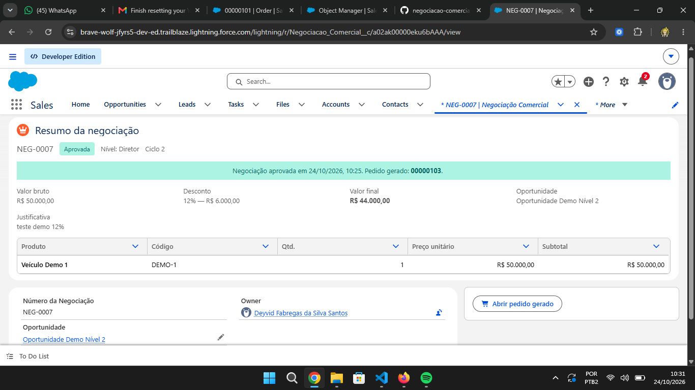 |
| Pendente, Gerente (6%) | 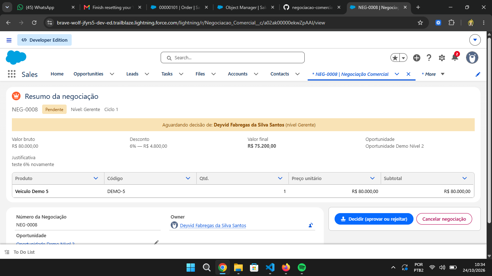 |
| Rascunho | 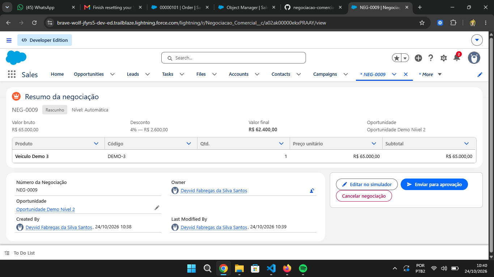 |
| Pendente, Diretor (20%) | 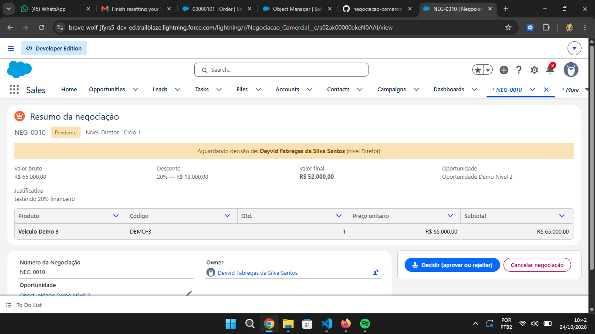 |
| Pendente, Financeiro (25%) | 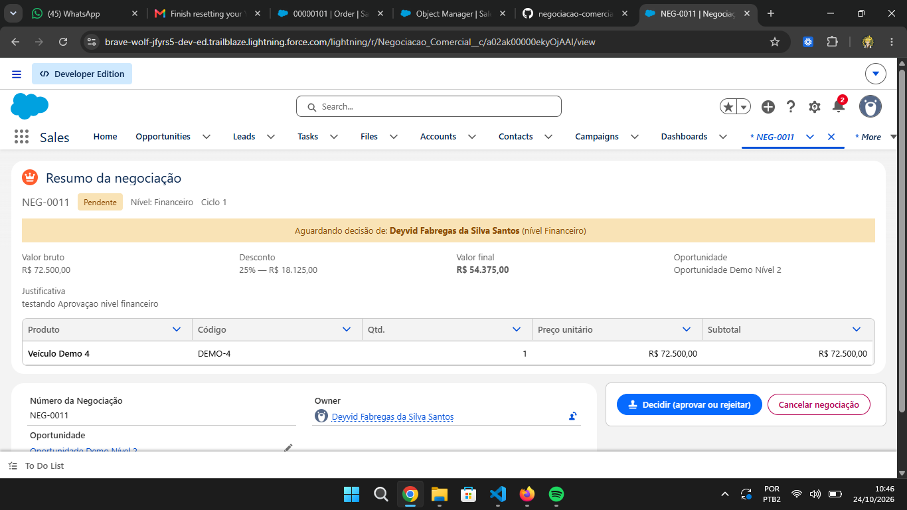 |
| Cancelada (NEG-0010), sem botões de ação | 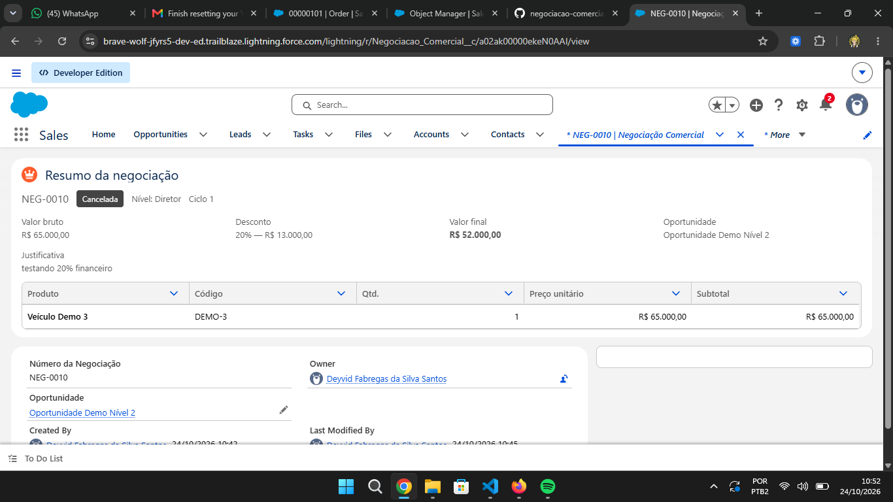 |
| Task de aprovação fechada (Completed) ao cancelar | 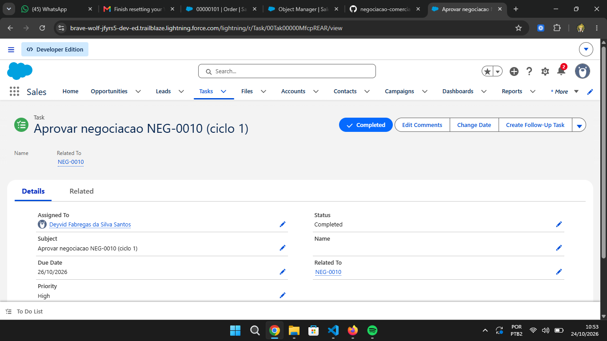 |
| Decisão do Financeiro (NEG-0011), modal | 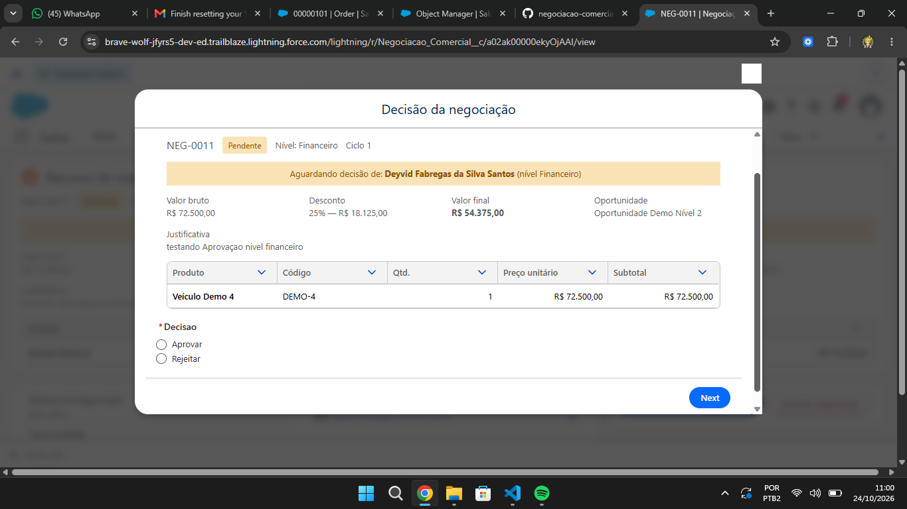 |
| NEG-0011 rejeitada com sucesso | 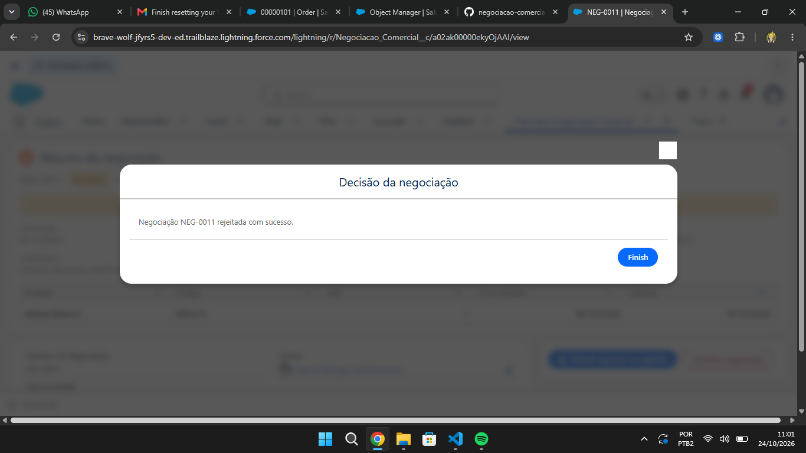 |
| Página no estado Rejeitada (motivo, Reabrir/Cancelar) | 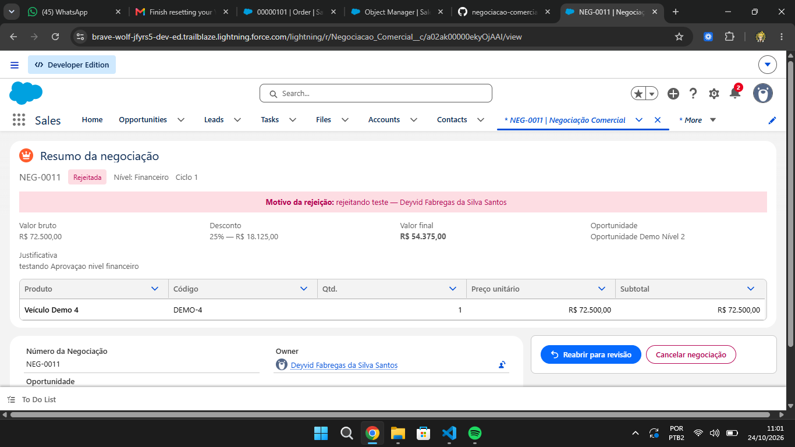 |

## Evidências a anexar na entrega
- [x] Execução dos testes Apex + cobertura (docs/evidencias/testes-apex-cobertura.txt)
- [x] Prints da FlexiPage nos 4 estados (Rascunho, Pendente, Aprovada, Rejeitada)
- [ ] Prints/gravação dos cenários da tabela dos Flows
- [ ] Gravação da demo (`docs/ROTEIRO_DEMO.md`) com ao menos um cenário de falha
